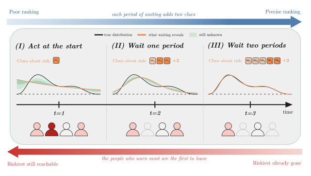

<h1 align="center">Waiting Buys Exactly Two Moments</h1>
<p align="center"><strong>Endogenous Identification in Prediction-Driven Allocation</strong></p>
<p align="center">Rama AlHamidi · Rasul Khanbayov · Erchin Serpedin · Hasan Kurban</p>

<p align="center">
  
  
</p>

<p align="center">
  <a href="#overview"><strong>Overview</strong></a> ·
  <a href="#installation"><strong>Installation</strong></a> ·
  <a href="#quick-start"><strong>Quick Start</strong></a> ·
  <a href="results/README.md"><strong>Results</strong></a> ·
  <a href="CITATION.cff"><strong>Citation</strong></a>
</p>

## Overview

**When should a planner act—and when is it worth waiting for more information?**

Waiting reveals risk, but attrition removes opportunities to intervene.
This repository connects observation, estimation, allocation timing, and
decision identification in one reproducible research implementation.

<p align="center">
  
</p>

| Component | What you can explore |
|---|---|
| **Moment identification** | What short observation prefixes reveal about latent risk |
| **Allocation timing** | How welfare changes with the intervention date |
| **Estimation and aggregation** | Certified NPMLE, early-stopped EM, bagging, and regret calibration |
| **Decision identification** | Exact certificates and compatible-population witnesses |
| **Mechanism studies** | How continued fitting changes allocation decisions |

## Installation

Use **Python 3.11 or newer**, from the repository root:

```bash
python -m venv .venv
source .venv/bin/activate
python -m pip install -c constraints.txt -e ".[test]"
python -m pip check
export OPENBLAS_NUM_THREADS=1 OMP_NUM_THREADS=1 MPLBACKEND=Agg
```

**CPU-only. No GPU, API key, database, or server required.**

Runtime dependencies are NumPy, SciPy, pandas, PyYAML, matplotlib,
highspy, and mpmath. Validated versions are pinned in `constraints.txt`.

## Quick Start

Compute the optimal single-date allocation for a reference population:

```python
from wtm.distributions import BetaRisk
from wtm.welfare import PopulationConfig

population = PopulationConfig(BetaRisk(1, 8), gamma=1, T=20, beta=0.002)
print("Optimal date:", population.t_star)
print("Optimal welfare:", population.W_star)
# Optimal date: 3
# Optimal welfare: approximately 0.001948
```

## Reproducibility

```bash
# Numerical and regression tests
python -m pytest -q experiments/tests

# Supporting EM study claims
python -m experiments.em_mechanism.verify_claims

# Exact decision-identification certificates
python experiments/scripts/verify_decision_certificates.py --out runs/certificates

# Build and verify a wheel outside the checkout
sh setup.sh
```

`setup.sh` is a package-validation helper. It creates a temporary
environment; it does not activate your development environment.

## Results & Repository Structure

Start with [the results guide](results/README.md) and
[the EM study guide](experiments/em_mechanism/README.md).

```text
.
├── wtm/                   # Model, simulation, fitting, welfare, timing rules
├── experiments/
│   ├── config/            # Frozen configurations and seeds
│   ├── scripts/           # Required generators and analyses
│   ├── tests/             # Numerical and artifact checks
│   ├── audit/             # Interpretation and implementation audits
│   ├── em_mechanism/      # Supporting EM studies and protocols
│   └── reports/           # Method specifications
├── results/               # Raw records, certificates, verification evidence
├── setup.sh               # Wheel installation check
├── pyproject.toml         # Package metadata and dependencies
├── constraints.txt        # Pinned dependency versions
└── CITATION.cff            # Author and citation metadata
```

All **24,000 CMS draw records** are retained in one compressed archive.
Required benchmark ensembles, exact certificates, and EM per-cell
data remain available for verification.

Inspect output paths before running generators: some overwrite saved
results. Use `runs/` for new outputs when supported. Full fitting sweeps
can take hours.

## Citation & License

Author and software metadata are provided in [CITATION.cff](CITATION.cff).
Include the repository revision, configuration, seeds, and input
artifacts when citing a computational result.

The license remains **undecided**. No license or reuse grant has been added.
